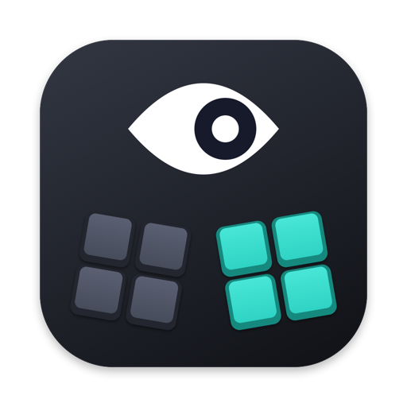
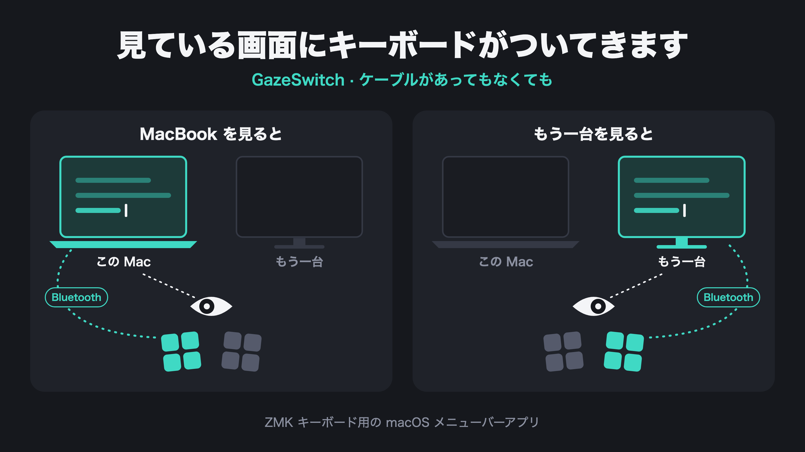

<p align="center"></p>

# zmk-gaze-switch

[English](README.md) · [한국어](README.ko.md) · [日本語](README.ja.md)

見ている画面のほうへ、キーボードの出力が切り替わります。

- MacBook の画面を見る → **この Mac**
- もう一台のコンピュータのほうを見る → **BLE プロファイル n(もう一台)**

<p align="center"></p>

使い方は二通りあります。

| | キーボードと Mac | 「この Mac」の意味 |
|---|---|---|
| **ケーブルあり** | USB で接続 | USB 出力 |
| **ケーブルなし** | Bluetooth でペアリング | この Mac がペアリングされている BLE プロファイル |

このリポジトリには二つのものが入っています。

| パス | 内容 |
|---|---|
| `/`(リポジトリのルート) | ZMK モジュール。ホストがキーボードの出力を切り替えられるスニペット |
| `app/` | **GazeSwitch**。MacBook のカメラで視線を判定し、上のコマンドを送るメニューバーアプリ |

```
MacBook のカメラ → GazeSwitch ──USB または Bluetooth──▶ キーボード(central)
                                                        ├─ この Mac  (USB、またはこの Mac の BLE プロファイル)
                                                        └─ もう一台  (BLE プロファイル n)
```

モジュールはアプリなしでも使えます。プロトコルが単純なので、ほかのスクリプトからも出力を切り替えられます。

> 確認したのは ZMK v0.3(Zephyr 3.5)ベースの nRF52840 ボード 1 種類(E24 ZEN)だけです。

## 1. ファームウェアにモジュールを追加する

`config/west.yml`:

```yaml
manifest:
  remotes:
    - name: aimdevlee
      url-base: https://github.com/aimdevlee
  projects:
    - name: zmk-gaze-switch
      remote: aimdevlee
      revision: v0.3.0
```

`build.yaml` で、central 側(分割型でなければキーボード本体)にスニペットを追加します。

```yaml
include:
  - board: nice_nano_v2
    shield: my_keyboard
    snippet: host-output-switch-hid
```

| スニペット | ホストとの通信経路 | ケーブルなしで動作 |
|---|---|---|
| `host-output-switch-hid` | ベンダー HID インターフェース(USB と Bluetooth) | はい |
| `host-output-switch` | USB シリアルポート | いいえ |

両方を書いてもかまいません。GazeSwitch は USB HID、USB シリアル、Bluetooth HID の順に選びます。
GazeSwitch 0.2.2 以前はシリアルにしか対応していません。その場合は `host-output-switch` を外さないでください。
`host-output-switch` を ZMK Studio と併用する場合は、`studio-rpc-usb-uart` を**先に**書いてください。

```yaml
    snippet: "studio-rpc-usb-uart host-output-switch host-output-switch-hid"
```

### 注意点

- もう一台のコンピュータは、あらかじめ BLE プロファイルの一つにペアリングしておきます(例: `&bt BT_SEL 1`)。
  ケーブルなしで使うなら、この Mac も別のプロファイルにペアリングしてください。
- `host-output-switch-hid`
  - USB HID インターフェースをもう一つ(`CONFIG_USB_HID_DEVICE_COUNT=2`、デバイス `HID_1`)、Bluetooth にも HID サービスを
    もう一つ追加します。`HID_1` を使うほかのモジュール(例: `zmk-raw-hid`)とは衝突するので、
    `CONFIG_ZMK_HOST_OUTPUT_SWITCH_HID_USB_DEVICE` でどちらかを移し、`CONFIG_USB_HID_DEVICE_COUNT` もそれに合わせて増やしてください。
  - `CONFIG_ZMK_HOST_OUTPUT_SWITCH_BLE_RECONNECT` も有効にします。ZMK は選択中のプロファイルが接続されるとアドバタイズを
    止めるため、別のプロファイルのコンピュータは接続が切れると(スリープ、Bluetooth オフ)戻ってこられません。
    このオプションを有効にすると、ペアリング済みのコンピュータが一台でも離れている間はアドバタイズを続けます。
    切断直後の 30 秒と、選択中のコンピュータが離れている間は速く、それ以外は 1 秒に 1 回ほどにして、
    キーボードのトラックボールやトラックパッドが遅くならないようにします。30 秒より長く離れていたコンピュータは、
    再接続に数秒余計にかかることがあります。
    **その分バッテリーを消費します。** ケーブルでしか使わないなら、`.conf` で `n` にしてください。
  - ファームウェアを書き込んだあと、すでにペアリングしていたコンピュータは、Bluetooth を一度オフ・オンしないと
    新しい HID 構成を認識しないことがあります。
- `host-output-switch`
  - `&zephyr_udc0` に CDC ACM ポートをもう一つ追加します。ボードに `zephyr_udc0` ラベルが必要です。
  - CDC ACM ポートが一つだけだと想定している機能(例: 1200 baud のブートローダートリガー)がある場合は、
    どのポートを監視するかを自分のオーバーレイで指定してください。

## 2. アプリなしで先に確認する

```bash
ls /dev/cu.usbmodem*
```

```bash
screen /dev/cu.usbmodemXXXX 115200
```

`?` と Enter を入力し、`ZMK-HOS 1 U 1 1` のように返ってくれば切り替え用のポートです。
`B1` で BLE プロファイル 1 に、`U` で USB に切り替わることを確認してください。
(`screen` の終了: `Ctrl-A` のあと `K`、`y`)

`host-output-switch-hid` だけを入れた場合、入力できるシリアルポートはありません。GazeSwitch を使うか、
usage page `0xFF9A` に 32 バイトのレポートを書ける HID ツールを使ってください([プロトコル](#プロトコル)を参照)。


## 3. GazeSwitch のインストール

[最新のリリース](https://github.com/aimdevlee/zmk-gaze-switch/releases/latest)から `GazeSwitch-x.y.z.dmg` をダウンロードして開き、`GazeSwitch` を
アプリケーションフォルダにドラッグして、そこから開きます。macOS 13 以降が必要で、Apple シリコンと Intel のどちらの Mac でも動きます。
署名と公証を済ませたアプリなので、警告なしで開けます。

### 自分でビルドする

Xcode コマンドラインツールが必要です。

```bash
cd app && ./bundle.sh
```

```bash
open app/GazeSwitch.app
```

初回起動時にカメラの許可を求められます。アプリはシステムの言語(日本語・英語・韓国語)に合わせて表示され、
メニューの**言語**から選ぶこともできます。メニューバーのアイコンから:

- **もう一台の BLE プロファイル**: ペアリングしたプロファイル番号を選びます。
- **キャリブレーション開始**(必須、約 1 分): MacBook の画面全体に案内が表示され、各ステップは音声でも読み上げられます
  (もう一台を見ている間はこの画面が見えないためです)。「ティン」という音で記録が始まり、「ポッ」という音で終わります。Esc でキャンセル。
  - MacBook を見る: 普段どおり → 頭を動かさず目だけ → 頭はもう一台のほう、目だけ MacBook
  - もう一台を見る: 普段どおり → 画面の両端 → 頭は MacBook の正面、目だけ → 頭を完全に向けて
- **今すぐこの Mac へ / 今すぐもう一台へ**: 手動切り替え。

### ケーブルなしで使う

キーボードをこの Mac と Bluetooth でペアリングします。もう一台が使っているプロファイルとは別のプロファイルにしてください。
GazeSwitch はキーボードを自動で見つけます。ケーブルがつながっていれば USB で、なければ Bluetooth でコマンドを送ります。
ケーブルがない間は、メニューに **Bluetooth で制御** と表示されます。

このとき「この Mac」は、この Mac がペアリングされているプロファイルを指します。設定で選ぶのは、これまでどおりもう一台のプロファイルだけです。


## 判定の仕組み

- フレームごとに六つの信号を読みます: 頭の左右・上下(Vision)、瞳の左右・上下(Vision のランドマーク)、
  虹彩の左右・上下(目の輪郭の内側にある暗いピクセルの中心)。
- キャリブレーションのデータから各信号の平均と**信号どうしの相関**を求め(LDA)、二つの画面を最もよく分ける組み合わせを探します。
  頭と目を別々に見るとあいまいでも、「頭の角度 + 目の角度」ははっきりしているためです。
- スコアは Mac 側を −0.5、もう一台側を +0.5 にそろえ、**±0.08 を超えた状態が 0.4 秒**続いたときだけ切り替えます。
- 顔が見えないときは現在の出力を保ちます。
- **マスクを着けていると**目の輪郭を正しく検出できないため、頭の向きだけで判定します。

## プライバシー

映像は保存も送信もしません。キャリブレーションの数値(数字のみ)は
`~/Library/Application Support/GazeSwitch/` に残り、この Mac の外には出ません。

目の検出がおかしいときの診断用に、キャリブレーション中の目の部分の画像を同じフォルダの `eyes/` に残すこともできます(既定はオフ)。

```bash
defaults write io.github.aimdevlee.GazeSwitch debugEyeImages -bool true
```

## プロトコル

コマンドはどちらの経路でも同じです。

| コマンド | 動作 |
|---|---|
| `U` | USB 出力を選択 |
| `B` | BLE 出力を選択(現在のプロファイルのまま) |
| `B<n>` | BLE プロファイル n を選択してから BLE 出力 |
| `M` | 送信元を選択。USB で届いたコマンドなら USB 出力、Bluetooth で届いたコマンドなら送信元の BLE プロファイル |
| `?` | 状態だけ応答 |

BLE プロファイルが未接続のときに `B` を送ると、ZMK は USB を使い続け、接続された時点で BLE に切り替わります。

### HID(`host-output-switch-hid`)

ベンダー HID インターフェースが一つあります。usage page `0xFF9A`、usage `0x01`、32 バイトのレポート、レポート ID なし。
コマンドを ASCII で出力レポートに書き、残りは 0 で埋めます。同じ接続に入力レポートが一つ返ります。

応答: `ZMK-HOS 2 <U|B> <プロファイル> <BLE 接続 0|1> <me 0|1> <送信元>`、失敗時は `ZMK-HOS 2 ERR`。
`<me>` は、選択中の出力が送信元なら 1 です。`<送信元>` は USB なら `U`、Bluetooth なら送信元の BLE プロファイルです。
Bluetooth の送信元がどのプロファイルにもない場合は `-` です(このとき `<me>` は 0 で、`M` は失敗します)。

次のコマンドは応答を受け取ってから送ってください。キーボードが溜めておけるコマンドは数個までです。
いっぱいのときに届いたコマンドは実行されず `ZMK-HOS 2 ERR` が返ります。この応答は、溜まっていたコマンドの応答のあとに届きます。

Bluetooth では、選択中のプロファイルのコンピュータだけでなく、ペアリング済みのどのコンピュータからもコマンドを送れます。
もう一台に切り替わっているキーボードを取り戻せるのはこのためです。

### シリアル(`host-output-switch`)

115200 baud、行単位(`\n` または `\r`)。ポートを開いた側が DTR を立てている間だけ応答します。

応答: `ZMK-HOS 1 <U|B> <プロファイル> <BLE 接続 0|1>`、失敗時は `ZMK-HOS 1 ERR`。


## 参考にしたもの

HID 通信は [zmk-raw-hid](https://github.com/zzeneg/zmk-raw-hid) と ZMK 自身の HID コードの方式に従っています。
USB HID デバイスをもう一つ、Bluetooth に HID サービスをもう一つ追加する方式です。コードは共有していません。
このモジュールは、コマンドの送信元を知り、その接続にだけ応答する必要があるため、独自に実装しています。

## ライセンス

MIT
