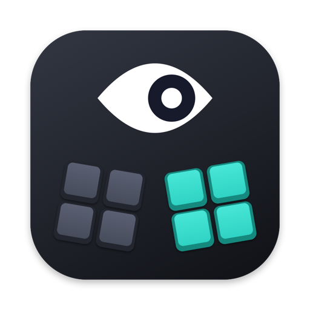

<p align="center"></p>

# zmk-gaze-switch

[English](README.md) · [한국어](README.ko.md) · [日本語](README.ja.md)

보고 있는 화면 쪽으로 키보드 출력이 따라가게 합니다.

- 맥북 화면을 보면 **이 맥**
- 다른 컴퓨터 쪽을 보면 **BLE 프로필 n(다른 컴퓨터)**

두 가지 방식으로 쓸 수 있습니다.

| | 키보드와 맥 | "이 맥"의 뜻 |
|---|---|---|
| **케이블 연결** | USB로 꽂음 | USB 출력 |
| **케이블 없이** | 블루투스로 페어링 | 이 맥이 페어링된 BLE 프로필 |

이 저장소에는 두 가지가 들어 있습니다.

| 경로 | 내용 |
|---|---|
| `/` (저장소 루트) | ZMK 모듈. 호스트가 키보드의 출력을 바꿀 수 있게 하는 스니펫 |
| `app/` | **GazeSwitch**. 맥북 카메라로 시선을 판단해 위 명령을 보내는 메뉴바 앱 |

```
맥북 카메라 → GazeSwitch ──USB 또는 블루투스──▶ 키보드(central)
                                                 ├─ 이 맥        (USB 또는 이 맥의 BLE 프로필)
                                                 └─ 다른 컴퓨터  (BLE 프로필 n)
```

모듈은 앱 없이도 쓸 수 있습니다. 프로토콜이 단순해서 다른 스크립트로도 출력을 바꿀 수 있어요.

> ZMK v0.3(Zephyr 3.5) 기반 nRF52840 보드 한 종류(E24 ZEN)에서만 확인했습니다.

## 1. 펌웨어에 모듈 넣기

`config/west.yml`:

```yaml
manifest:
  remotes:
    - name: aimdevlee
      url-base: https://github.com/aimdevlee
  projects:
    - name: zmk-gaze-switch
      remote: aimdevlee
      revision: v0.3.0
```

`build.yaml`에서 central 쪽(분리형이 아니면 키보드 자체)에 스니펫을 추가합니다.

```yaml
include:
  - board: nice_nano_v2
    shield: my_keyboard
    snippet: host-output-switch-hid
```

| 스니펫 | 호스트와 통신하는 길 | 케이블 없이 동작 |
|---|---|---|
| `host-output-switch-hid` | 벤더 HID 인터페이스 (USB와 블루투스) | 예 |
| `host-output-switch` | USB 시리얼 포트 | 아니요 |

둘을 함께 적어도 됩니다. GazeSwitch는 USB HID, USB 시리얼, 블루투스 HID 순으로 고릅니다.
`host-output-switch`를 ZMK Studio와 같이 쓴다면 `studio-rpc-usb-uart`를 **앞에** 적으세요.

```yaml
    snippet: "studio-rpc-usb-uart host-output-switch host-output-switch-hid"
```

### 알아 둘 점

- 다른 컴퓨터는 미리 BLE 프로필 하나에 페어링해 둡니다(예: `&bt BT_SEL 1`).
  케이블 없이 쓰려면 이 맥도 다른 프로필에 페어링하세요.
- `host-output-switch-hid`
  - USB HID 인터페이스를 하나 더 만들고(`CONFIG_USB_HID_DEVICE_COUNT=2`, 장치 `HID_1`), 블루투스에도 HID 서비스를
    하나 더 만듭니다. `HID_1`을 쓰는 다른 모듈(예: `zmk-raw-hid`)과는 충돌하니,
    `CONFIG_ZMK_HOST_OUTPUT_SWITCH_HID_USB_DEVICE`로 한쪽을 옮기세요.
  - `CONFIG_ZMK_HOST_OUTPUT_SWITCH_BLE_RECONNECT`도 함께 켭니다. ZMK는 선택된 프로필이 연결되면 광고를 멈추기 때문에,
    다른 프로필의 컴퓨터는 연결이 끊기면(잠자기, 블루투스 끔) 다시 들어오지 못합니다. 이 옵션을 켜면 페어링된
    컴퓨터가 하나라도 떨어져 있는 동안 광고를 계속합니다. **그만큼 배터리를 더 씁니다.** 케이블로만 쓴다면
    `.conf`에서 `n`으로 끄세요.
  - 펌웨어를 구운 뒤, 이미 페어링되어 있던 컴퓨터는 블루투스를 한 번 껐다 켜야 새 HID 구성을 알아볼 수 있습니다.
- `host-output-switch`
  - `&zephyr_udc0`에 CDC ACM 포트를 하나 더 만듭니다. 보드에 `zephyr_udc0` 라벨이 있어야 합니다.
  - CDC ACM 포트가 하나라고 가정하는 기능(예: 1200 baud 부트로더 트리거)이 있으면,
    그 기능이 어느 포트를 볼지 직접 오버레이에서 지정해 주세요.

## 2. 앱 없이 먼저 확인하기

```bash
ls /dev/cu.usbmodem*
```

```bash
screen /dev/cu.usbmodemXXXX 115200
```

`?` 엔터 → `ZMK-HOS 1 U 1 1`처럼 응답하면 전환용 포트입니다.
`B1` 엔터로 BLE 프로필 1, `U` 엔터로 USB로 바뀌는지 확인하세요.
(`screen` 종료: `Ctrl-A` 다음 `K`, `y`)

`host-output-switch-hid`만 넣었다면 입력해 볼 시리얼 포트가 없습니다. GazeSwitch를 쓰거나,
usage page `0xFF9A`에 32바이트 리포트를 쓸 수 있는 HID 도구를 쓰세요([프로토콜](#프로토콜) 참고).


## 3. GazeSwitch 설치

[최신 릴리스](https://github.com/aimdevlee/zmk-gaze-switch/releases/latest)에서 `GazeSwitch-x.y.z.dmg`를 받아 열고, `GazeSwitch`를
응용 프로그램 폴더로 끌어다 놓은 뒤 거기서 실행합니다. macOS 13 이상이 필요하고, Apple 실리콘과 Intel 맥 모두에서 동작합니다.
서명과 공증을 거친 앱이라 경고 없이 열립니다.

### 직접 빌드하기

Xcode 명령줄 도구가 필요합니다.

```bash
cd app && ./bundle.sh
```

```bash
open app/GazeSwitch.app
```

처음 실행하면 카메라 권한을 묻습니다. 앱은 시스템 언어(한국어·영어·일본어)를 따르고,
메뉴의 **언어**에서 직접 고를 수도 있습니다. 메뉴바 아이콘 메뉴에서:

- **다른 컴퓨터의 BLE 프로필**: 페어링해 둔 프로필 번호를 고릅니다.
- **보정 시작 (필수, 약 1분)**: 맥북 화면 전체에 안내가 뜨고 각 단계를 음성으로도 읽어 줍니다
  (다른 컴퓨터를 보는 동안에는 이 화면을 못 보니까요). "띵" 소리에 기록을 시작하고 "톡" 소리에 끝납니다. Esc로 취소.
  - 맥북 보기: 평소처럼 → 고개 고정하고 눈만 → 고개는 다른 컴퓨터 쪽, 눈만 맥북
  - 다른 컴퓨터 보기: 평소처럼 → 화면 양 끝 → 고개는 맥북 정면, 눈만 → 고개를 완전히 돌려서
- **지금 이 맥으로 / 지금 다른 컴퓨터로**: 수동 전환.

### 케이블 없이 쓰기

키보드를 이 맥과 블루투스로 페어링합니다. 다른 컴퓨터가 쓰는 프로필과 다른 프로필이어야 합니다.
GazeSwitch는 키보드를 알아서 찾습니다. 케이블이 꽂혀 있으면 USB로, 없으면 블루투스로 명령을 보냅니다.
케이블이 없는 동안에는 메뉴에 **블루투스로 제어**라고 표시됩니다.

이때 "이 맥"은 이 맥이 페어링된 프로필을 뜻합니다. 설정에서 고르는 것은 여전히 다른 컴퓨터의 프로필뿐입니다.


## 판단 방식

- 프레임마다 여섯 신호를 읽습니다: 고개 좌우·상하(Vision), 눈동자 좌우·상하(Vision 랜드마크),
  홍채 좌우·상하(눈 윤곽 안의 어두운 픽셀 중심).
- 보정 데이터에서 신호들의 평균과 **서로 간의 상관관계**를 구해(LDA), 두 화면을 가장 잘 가르는 조합을 찾습니다.
  고개와 눈을 따로 보면 애매해도 "고개 각도 + 눈 각도"의 합은 분명하기 때문입니다.
- 점수는 맥 쪽 −0.5, 다른 컴퓨터 쪽 +0.5로 맞추고, **±0.08을 넘은 채 0.4초** 유지해야 전환합니다.
- 얼굴이 안 보이면 현재 상태를 유지합니다.
- **마스크를 쓰면** 눈 윤곽이 제대로 잡히지 않아서 고개 방향만으로 판단합니다.

## 개인정보

영상은 저장하거나 전송하지 않습니다. 보정 수치(숫자만)는
`~/Library/Application Support/GazeSwitch/`에 남고, 이 맥 밖으로 나가지 않습니다.

눈 인식이 이상할 때 진단용으로, 보정 중의 눈 부분 사진을 같은 폴더의 `eyes/`에 남기게 할 수 있습니다(기본은 꺼짐).

```bash
defaults write io.github.aimdevlee.GazeSwitch debugEyeImages -bool true
```

## 프로토콜

명령은 두 통로에서 같습니다.

| 명령 | 동작 |
|---|---|
| `U` | USB 출력 선택 |
| `B` | BLE 출력 선택 (현재 프로필 유지) |
| `B<n>` | BLE 프로필 n 선택 후 BLE 출력 |
| `M` | 보낸 쪽을 선택. USB로 온 명령이면 USB 출력, 블루투스로 온 명령이면 보낸 컴퓨터의 BLE 프로필 |
| `?` | 상태만 응답 |

BLE 프로필이 연결되지 않은 상태에서 `B`를 보내면 ZMK가 USB를 계속 쓰다가, 연결되는 순간 BLE로 넘어갑니다.

### HID (`host-output-switch-hid`)

벤더 HID 인터페이스 하나입니다. usage page `0xFF9A`, usage `0x01`, 32바이트 리포트, 리포트 ID 없음.
명령을 ASCII로 출력 리포트에 쓰고 나머지는 0으로 채웁니다. 같은 연결로 입력 리포트 하나가 돌아옵니다.

응답: `ZMK-HOS 2 <U|B> <프로필> <BLE 연결 0|1> <me 0|1> <보낸 쪽>`, 실패하면 `ZMK-HOS 2 ERR`.
`<me>`는 선택된 출력이 보낸 쪽이면 1입니다. `<보낸 쪽>`은 USB면 `U`, 블루투스면 보낸 컴퓨터의 BLE 프로필입니다.
블루투스로 보낸 컴퓨터가 어느 프로필에도 없으면 `-`입니다(이때 `<me>`는 0이고 `M`은 실패합니다).

블루투스에서는 선택된 프로필의 컴퓨터뿐 아니라 페어링된 어느 컴퓨터든 명령을 보낼 수 있습니다.
다른 컴퓨터에 가 있는 키보드를 되찾아 올 수 있는 이유입니다.

### 시리얼 (`host-output-switch`)

115200 baud, 줄 단위(`\n` 또는 `\r`). 포트를 연 쪽이 DTR을 올려야 응답합니다.

응답: `ZMK-HOS 1 <U|B> <프로필> <BLE 연결 0|1>`, 실패하면 `ZMK-HOS 1 ERR`.


## 라이선스

MIT
