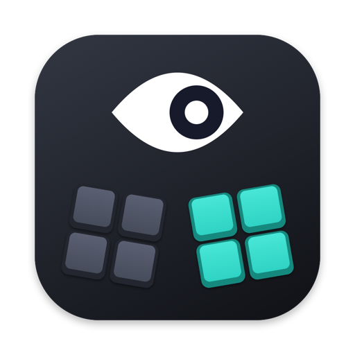

<p align="center"></p>

# zmk-gaze-switch

[English](README.md) · [한국어](README.ko.md) · [日本語](README.ja.md)

Your keyboard's output follows the screen you are looking at.

- Look at the MacBook screen → **this Mac**
- Look toward the other computer → **BLE profile n (the other computer)**

It works in two ways.

| | Keyboard and Mac | "This Mac" means |
|---|---|---|
| **With a cable** | Plugged in over USB | The USB output |
| **Without a cable** | Paired over Bluetooth | The BLE profile this Mac is paired on |

This repository holds two things.

| Path | Contents |
|---|---|
| `/` (repository root) | A ZMK module. Its snippets let a host change the keyboard's output |
| `app/` | **GazeSwitch**, a menu bar app that reads your gaze from the MacBook camera and sends those commands |

```
MacBook camera → GazeSwitch ──USB or Bluetooth──▶ keyboard (central)
                                                   ├─ this Mac        (USB, or its BLE profile)
                                                   └─ other computer  (BLE profile n)
```

The module is usable without the app: the protocol is simple enough to drive from any script.

> Tested on one nRF52840 board only (E24 ZEN), on ZMK v0.3 (Zephyr 3.5).

## 1. Add the module to your firmware

`config/west.yml`:

```yaml
manifest:
  remotes:
    - name: aimdevlee
      url-base: https://github.com/aimdevlee
  projects:
    - name: zmk-gaze-switch
      remote: aimdevlee
      revision: v0.3.0
```

In `build.yaml`, add a snippet to the central half (the only half, on a non-split keyboard).

```yaml
include:
  - board: nice_nano_v2
    shield: my_keyboard
    snippet: host-output-switch-hid
```

| Snippet | The host talks over | Works without a cable |
|---|---|---|
| `host-output-switch-hid` | A vendor HID interface, on USB and Bluetooth | Yes |
| `host-output-switch` | A USB serial port | No |

You can list both. GazeSwitch prefers USB HID, then USB serial, then Bluetooth HID.
GazeSwitch 0.2.2 and earlier only speak serial; with those, keep `host-output-switch` in the list.
If you also use ZMK Studio together with `host-output-switch`, list `studio-rpc-usb-uart` **first**.

```yaml
    snippet: "studio-rpc-usb-uart host-output-switch host-output-switch-hid"
```

### Things to know

- Pair the other computer to a BLE profile beforehand (for example `&bt BT_SEL 1`).
  To use it without a cable, pair this Mac to a different profile too.
- `host-output-switch-hid`
  - It adds a second USB HID interface (`CONFIG_USB_HID_DEVICE_COUNT=2`, device `HID_1`) and a second
    HID service over Bluetooth. Another module that claims `HID_1` (for example `zmk-raw-hid`) conflicts with it;
    move one of them with `CONFIG_ZMK_HOST_OUTPUT_SWITCH_HID_USB_DEVICE` and raise `CONFIG_USB_HID_DEVICE_COUNT` to match.
  - It also turns on `CONFIG_ZMK_HOST_OUTPUT_SWITCH_BLE_RECONNECT`. ZMK normally stops advertising once the
    selected profile is connected, so a computer on another profile that drops its link (sleep, Bluetooth off)
    could not come back. With this option the keyboard keeps advertising while any paired computer is away.
    **That costs battery.** Set it to `n` in your `.conf` if you only ever use the cable.
  - After flashing, a computer that was already paired may keep the old HID layout until its Bluetooth is
    switched off and on once.
- `host-output-switch`
  - It adds one more CDC ACM port on `&zephyr_udc0`, so your board needs a `zephyr_udc0` label.
  - If you use a feature that assumes a single CDC ACM port (for example a 1200-baud bootloader trigger),
    point it at the port it should watch in your own overlay.

## 2. Check it without the app

```bash
ls /dev/cu.usbmodem*
```

```bash
screen /dev/cu.usbmodemXXXX 115200
```

Type `?` and Enter. A reply like `ZMK-HOS 1 U 1 1` means this is the switch port.
Check that `B1` selects BLE profile 1 and `U` goes back to USB.
(To quit `screen`: `Ctrl-A`, then `K`, `y`.)

With only `host-output-switch-hid` there is no serial port to type into; use GazeSwitch, or any HID tool
that can write a 32-byte report to usage page `0xFF9A` (see [Protocol](#protocol)).


## 3. Install GazeSwitch

Download `GazeSwitch-x.y.z.dmg` from the [latest release](https://github.com/aimdevlee/zmk-gaze-switch/releases/latest), open it, drag `GazeSwitch`
onto the Applications folder and open it from there. It needs macOS 13 or later and runs on both Apple silicon and Intel Macs.
The app is signed and notarized, so it opens without a warning.

### Or build it yourself

Requires the Xcode command line tools.

```bash
cd app && ./bundle.sh
```

```bash
open app/GazeSwitch.app
```

The first launch asks for camera access. The app follows the system language (English, Korean or Japanese);
you can also pick one under **Language** in the menu. From the menu bar icon:

- **BLE profile of the other computer**: pick the profile you paired.
- **Start calibration** (required, about one minute): a full-screen guide appears on the MacBook
  and each step is also read aloud, because you can't see this screen while looking at the other computer.
  Recording starts on the "ting" sound and ends on the "pop". Press Esc to cancel.
  - Looking at the MacBook: naturally → head still, eyes only → head toward the other computer, eyes on the MacBook
  - Looking at the other computer: naturally → both edges of its screen → head facing the MacBook, eyes only → head fully turned
- **Switch to this Mac now / Switch to the other computer now**: manual switch.

### Without a cable

Pair the keyboard with this Mac over Bluetooth, on a profile other than the one the other computer uses.
GazeSwitch finds the keyboard by itself: over USB when the cable is in, over Bluetooth when it is not.
The menu shows **controlled over Bluetooth** while there is no cable.

"This Mac" then means the profile this Mac is paired on; you still only choose the other computer's profile.


## How it decides

- Six signals are read per frame: head yaw and pitch (Vision), pupil position left-right and up-down
  (Vision landmarks), and iris position left-right and up-down (centre of the dark pixels inside the eye outline).
- From the calibration data it takes each signal's mean and the **correlations between signals** (LDA)
  and finds the combination that best separates the two screens. Head and eyes are each ambiguous on
  their own, but "head angle + eye angle" is not.
- The score is scaled to −0.5 for the Mac and +0.5 for the other computer. It switches only after the
  score stays **beyond ±0.08 for 0.4 seconds**.
- When no face is visible it keeps the current output.
- **With a mask on**, the eye outline is not detected reliably, so only head direction is used.

## Privacy

No video is stored or sent anywhere. Calibration numbers (numbers only) are kept in
`~/Library/Application Support/GazeSwitch/` and never leave this Mac.

To diagnose eye detection, you can have it keep cropped eye images from calibration in `eyes/`
inside that folder (off by default).

```bash
defaults write io.github.aimdevlee.GazeSwitch debugEyeImages -bool true
```

## Protocol

The commands are the same on both transports.

| Command | Action |
|---|---|
| `U` | Select the USB output |
| `B` | Select the BLE output (keep the current profile) |
| `B<n>` | Select BLE profile n, then the BLE output |
| `M` | Select the sender: the USB output if the command came over USB, the sender's own BLE profile if it came over Bluetooth |
| `?` | Report state only |

If you send `B` while the BLE profile is not connected, ZMK keeps using USB and moves to BLE the moment it connects.

### HID (`host-output-switch-hid`)

One vendor HID interface: usage page `0xFF9A`, usage `0x01`, 32-byte reports, no report ID.
Write the command as ASCII in an output report, zero padded. One input report comes back on the same link.

Reply: `ZMK-HOS 2 <U|B> <profile> <BLE connected 0|1> <me 0|1> <sender>`, or `ZMK-HOS 2 ERR` on failure.
`<me>` is 1 when the selected output is the sender. `<sender>` is `U` over USB, the sender's BLE profile over Bluetooth, or `-` when a Bluetooth sender is on no profile
(`<me>` is then 0 and `M` fails).

Wait for the reply before you send the next command. The keyboard holds a few commands at most; one that arrives
while it is full is not run and gets `ZMK-HOS 2 ERR`, after the replies to the ones it was holding.

Over Bluetooth, any paired computer can send commands, not only the one on the selected profile.
That is how a computer takes the keyboard back.

### Serial (`host-output-switch`)

115200 baud, line based (`\n` or `\r`). The keyboard replies only while the host asserts DTR.

Reply: `ZMK-HOS 1 <U|B> <profile> <BLE connected 0|1>`, or `ZMK-HOS 1 ERR` on failure.


## License

MIT
